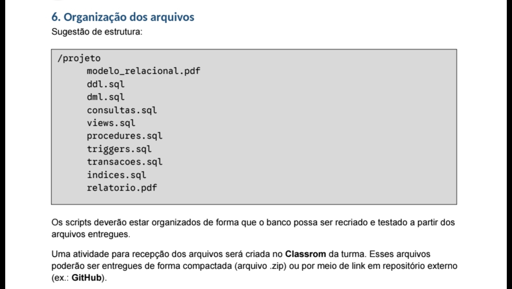

# documento compartilhado:

https://docs.google.com/document/d/1N8fVItlQHlc3d8A3M6tPlp3m2mhZFzzxIxvzMg-CK-E/edit?tab=t.0
> [!NOTE]
> entrar com email educacional

# estrutura de arquivos:

---
# regras de negocio

### do professor
1. Um mesmo curso poderá ser oferecido em várias turmas em períodos diferentes.
2. Cada turma deverá possuir período de realização e capacidade máxima de participantes.
3. Uma pessoa poderá participar de diferentes cursos ao longo do tempo.
4. Uma turma poderá contar com um ou mais instrutores.
5. Um instrutor poderá participar de diferentes turmas, inclusive de cursos distintos.
6. As atividades realizadas durante o curso poderão ocorrer em datas diferentes.
7. A escola deseja acompanhar a presença dos participantes nas atividades.
8. A conclusão poderá depender de critérios como frequência mínima ou desempenho.
9. Quando os critérios forem atendidos, poderá ser emitido certificado.
10. A inscrição poderá ter valor próprio e o pagamento poderá possuir diferentes situações.

### proprias
11. todo aluno deve possuir um endereço, até 2 telefones e um e-mail.
12. todo instrutor deve possuis até 2 telefones e um e-mail.
13. todo pagamento deve está vinculado a um aluno.
14. o valor do pagamento é definido na inscrição.
15. toda turma deve ter um curso e um instrutor responsável. 
16. toda turma não deve ter mais de um determinado numero de alunos alocados.
17. toda turma tem uma carga horaria total associada.
18. toda atividade deve ter uma quantidade de carga horaria abatida da carga horaria da turma.
19. a soma das carga horaria da atividade não deve ser superior a a carga horaria da turma. 
20. toda atividade deve atribuir uma frequência e uma nota individual para cada aluno.
21. a nota da atividade deve ser de 0 a 10. 
22. um aluno só poderá resgatar um certificado se a sua media de nota for igual ou superior a 7.0 e a frequência for maior que 70% e a carga horaria da turma foi completamente abatida.
23. um aluno somente poderá ser alocado em uma turma se o estados de pagamento respectivo estiver com status "pago".
24. um pagamento so pode ser criado se o aluno estiver inscrito 

---
# triggers

### t-01 alocado 
- [x] feito  
pre-insert.  
verificar se o pagamento respectivo está com status pago e se a turma está com vagas disponíveis.  
---
### t-02 atividade
- [x] feito  
pre-insert.  
verificar se a soma das cargas horarias das atividades da turma superam a carga horaria máxima da turma, bloquear se sim. 
---
### t-03 pagamento
- [x] feito  
pre-update. 
verificar a se o status está sendo atualizado e se a ordem de progresso está sendo respeitada.  

|Status atual|Próximo status permitido|
|---|---|
|`pendente`| `processando`, `vencido`|
|`processando`| `pago`, `pendente`, `vencido`  |
|`pago`| Nenhum|
|`vencido`| `pendente`, `processando`|

**Justificativas:**

- `pendente → processando`: pagamento iniciado.
- `pendente → vencido`: prazo de pagamento expirado.
- `processando → pago`: pagamento confirmado.
- `processando → pendente`: processamento cancelado ou não concluído.
- `processando → vencido`: prazo expirado durante o processamento.
- `vencido → pendente`: pagamento reaberto.
- `vencido → processando`: pagamento iniciado após reabertura.

---
### t-04 pagamento
- [x] feito  
pre-update.  
validar data_de_pagamento impedir que a data venha de fora e inserir caso o novo status esteja correto.
inserir `data_de_pagamento` se o novo status for `pago`.  
---

### t-05 pagamento 
- [x] feito  
pre-insert.  
verificar se o aluno esta incrito em um curso antes inserir o registro de pagamento

### t-06 pagamento
- [x] feito  
pre-insert.  
verificar se estado do insert está em um estado valido.
todo pagamento deve ser criado como pendente.

### t-07 alunos 
- [x] feito  
pre-insert.  
impedir valor externos de matricular e colocar a matricula gerada pela a procedure

### t-08 instrutores
- [x] feito  
pre-insert  
impedir valor externos de matricular e colocar a matricula gerada pela a procedure

---
# procedures 

### p-01 alocar aluno
- [ ] feito 

-**recebe**: matricula, cpf, ID da turma.
verifica de o aluno tem o status de pago.
verifica se a turma tem vaga.
e verifica se o aluno esta alocado em outra turma.

---

### p-02 registrar_pagamento 
- [ ] feito 

-**recebe**: id da inscrição ou (matrícula + curso), forma de pagamento e data.
atualiza o status do pagamento para o pago e preenche a data de pagamento.
dispensa se o aluno já estiver alocado e cria o registro do pagamento.

---

### p-03 matricula_do_aluno
- [ ] feito 

-**recebe**: nome, sexo, CPF, e-mail, data de nascimento.
gera a matrícula do aluno.
cria o registro de endereço.
cria o registro de telefone.
insere o aluno na tabela Alunos já vinculando o endereço e o telefone.
Retorna a matrícula gerada.
valida se o CPF já existe nao permitir duplicidade.

---

### p-04 Situação_Aluno_Turma
- [ ] feito 

Presença>75%
Nota>6 
Se tiver isso o certificado poderá ser emitido

---

# views

### v-01 atividades da turma 
- [x] feito  

cada linha contem:  
- id_da_atividade, id_da_turma descrição, data, carga horaria,  quantidades de alunos presente, quantidades de alunos totais, taxa de presença , media da nota dos alunos presentes. 

---
### v-02 alunos prontos para ser alocados
- [x] feito  

cada linha contem:  
- nome do aluno,  CPF e a matricula, curso inscrito, data de pagamento, o valor da inscrição (ou o total caso seja possível se inscrever em mais) 
mostrar somente alunos que possuem statos de pagamento 'pago' e não estão em uma turma.

---

# indeces 

---

# Consultas

* Alunos, cursos e turmas

Lista os alunos e os respectivos cursos e turmas em que estão alocados.

* Turmas e instrutores

Apresenta as turmas, seus cursos e os instrutores responsáveis.

* Frequência e notas dos alunos

Consulta a frequência e as notas dos alunos em cada atividade.

* Turmas com média igual ou superior a 7

Identifica as turmas cuja média geral das notas é igual ou superior a 7.

* Alunos com notas acima da média geral

Identifica os alunos com notas superiores à média de todas as notas registradas.

* Situação dos pagamentos

Apresenta a situação dos pagamentos, suas formas de pagamento, datas de vencimento e dias de atraso.

* Atividades com carga horária acima da média da turma

Identifica as atividades cuja carga horária é superior à média das atividades da mesma turma.

* Vagas disponíveis nas turmas

Apresenta a capacidade máxima, a quantidade de alunos alocados e as vagas restantes.

* Carga horária das atividades por turma

Apresenta a quantidade de atividades, a carga horária total cadastrada e as horas restantes de cada turma.

* Alunos aptos a receber certificado

Identifica os alunos que atendem aos critérios de média, frequência e cumprimento da carga horária para certificação.

# transações

---
# to-do
- [x] `procedure`: criar matricula de aluno  
- [x] `procedure`: criar matricula de instrutores
- [x] `trigger`: pre-insert alunos, impedir valor externos de matricular e colocar a matricula gerada pela a procedure
- [x] `trigger`: pre-insert instrutores, impedir valor externos de matricular e colocar a matricula gerada pela a procedure
- [ ] `indices`: decidir quais campos criar indices
- [x] `consultas`: decidir quais consultas criar
- [x] `trigger `: t-07, ligar o gerador de matricula do aluno
- [x] `trigger `: t-08, ligar o gerador de matricula do instrutores
